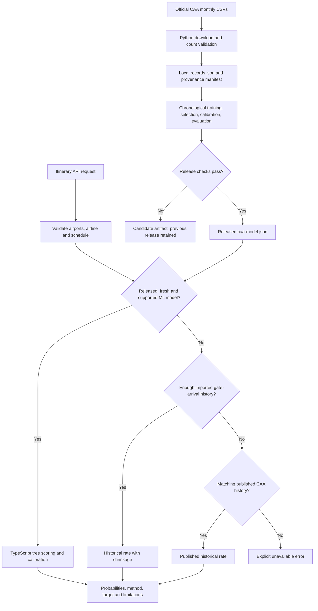

# ML backend: architecture, data, training, and operation

This guide describes the implementation in this repository and the bundled model inspected on **16 October 2026**. Dataset totals, selected model settings, and evaluation scores below describe that artifact; they will change after retraining. Use the status endpoints and generated evaluation report for the model actually deployed.

## 1. What the backend does

The main prediction backend estimates the probability of a flight being **strictly more than 30, 60, or 180 minutes late** at a supported UK reporting airport. It uses a calibrated LightGBM model trained on official UK Civil Aviation Authority (CAA) monthly punctuality reports.

The central limitation: **these reports contain monthly route/airline/direction totals, not individual flight histories**. The model estimates seasonal cohort risk. Two requests with the same route, airline, direction, and departure month receive the same model scores. It cannot distinguish their aircraft, weather, crew, or operational situation.

Training runs offline in Python. Serving runs in TypeScript inside the existing Next.js API or an optional AWS Lambda deployment. There is no Flask/FastAPI service, Python inference process, GPU requirement, or separate ML database.

| Component | Role | Implementation |
| --- | --- | --- |
| Data acquisition | Download and validate official monthly CSVs | [scripts/import-caa.py](../scripts/import-caa.py) |
| Feature and target preparation | Normalize cohorts, encode inputs, define time partitions | [ml/caa_model.py](../ml/caa_model.py) |
| Training and evaluation | Select LightGBM models, calibrate probabilities, apply release checks | [ml/train_caa.py](../ml/train_caa.py) |
| Released artifact | Numeric trees, calibration, coverage, baselines, metrics | [ml/models/caa-model.json](../ml/models/caa-model.json) |
| Runtime inference | Validate/load the artifact and traverse exported trees | [lib/predictions/caa-ml.ts](../lib/predictions/caa-ml.ts) |
| Prediction orchestration | Try ML, then eligible historical estimates | [lib/predictions/schedule-service.ts](../lib/predictions/schedule-service.ts) |
| HTTP API | Validate requests and optionally proxy schedule calls | [app/api/[...path]/route.ts](../app/api/%5B...path%5D/route.ts) |
| Optional private API | Serve the same schedule service in Lambda | [aws/predictions.ts](../aws/predictions.ts) |

## 2. How a prediction flows through the system



For a complete itinerary, the API requires known, distinct airports, an operating airline, and scheduled departure/arrival in **Unix seconds**. Arrival must follow departure within 24 hours. A new estimate requires at least one hour before departure.

The ML branch also checks:

1. The artifact matches the expected schema, feature order, and chronological partition contract.
2. Its release gate passed, and its training/calibration timestamps are not in the future.
3. Its latest calibration month is no more than 180 days old, measured from the first instant of the following month.
4. Departure is within the next 180 days and at least one hour away.
5. The exact route/airline/direction combination had at least **100 matched movements across three distinct training months**.

The loader caches the parsed artifact and reloads when its path, modification time, or size changes. No database query is needed to score a supported itinerary through the ML branch. Status, flight boards, and historical fallbacks have additional database needs. An unsupported ML request proceeds to historical methods; `available: true` in model status does not mean every route is supported.

Historical fallback errors can still stop a request: the service queries imported history before published CAA history, so a database failure is not guaranteed to produce a published fallback.

## 3. Dataset: source, contents, and coverage

### Official source and local files

The downloader discovers **Full Analysis Arrival Departure** CSV links on the CAA annual punctuality pages. The bundled artifact records 44 reporting months, January 2023 through August 2026. Its exact source URLs are stored in the artifact and the [evaluation report](caa-model-evaluation.json).

Source entry point: [UK CAA flight punctuality statistics](https://www.caa.co.uk/data-and-analysis/uk-aviation-market/flight-punctuality/uk-flight-punctuality-statistics/).

```text
ml/datasets/caa/
  YYYYMM.csv       Original downloaded report bytes, one file per month
  records.json     Validated aggregates used as training input
  manifest.json    Source URLs, file SHA-256 hashes, sizes and preparation metadata
```

These downloads are ignored by Git. The released model is included in the repository, so serving it does not require downloading the reports again.

The importer caches CSVs unless `--refresh` is used, but still contacts the annual pages to discover links. Its `retrievedAt` metadata records the preparation invocation; for cached files, this should not be interpreted as an independently preserved original download timestamp. URLs and checksums identify the bytes used. Later publisher revisions can change those bytes.

### What one record represents

A record is one **reporting month + reporting airport + other airport + airline + arrival/departure direction** cohort. Important fields are:

| Field | Meaning / use |
| --- | --- |
| `period` | Reporting month as `YYYYMM`; supplies seasonal month features |
| `reportingAirport`, `otherAirport` | Mapped ICAO codes; combined with direction to derive origin/destination |
| `airline` | Published operating airline name, normalized to uppercase |
| `direction` | `A` for arrival at the reporting airport; `D` for departure from it |
| `matched` | Operated movements with matched punctuality data; delay target denominator |
| `unmatched`, `cancelled` | Separate counts, excluded from the ML delay denominator |
| `late30`, `late60`, `late180` | Reconstructed integer counts strictly above each delay threshold |
| `averageDelay` | Retained source statistic; **not an ML input** |
| `sourceUrl`, `sourceRunDate`, `retrievedAt` | Provenance metadata; **not ML inputs** |

The downloader retains scheduled services (`scheduled_charter = S`), skips unknown airport mappings and cohorts with zero matched movements, and rejects invalid counts or duplicate cohort identities.

Published delay-band percentages use **matched + unmatched + cancelled** movements as their original denominator. The importer reconstructs counts with:

```text
all_movements = matched + unmatched + cancelled
band_count = round(published_band_percent * all_movements / 100)
```

It checks that reconstructed bands sum to `matched` and that rounding discrepancies are within the implemented tolerance. It then sums bands beginning at 31, 61, and 181 minutes for the three targets. The model's delay rates divide these counts by `matched`, not by all movements. Using the wrong denominator would silently produce wrong targets.

### Bundled dataset snapshot

| Property | Value |
| --- | --- |
| European training/evaluation input cohorts, before partition filtering | 13,908 |
| Matched movements represented by those cohorts | 1,058,694 |
| Individual flight records | **0** |
| Reporting months | January 2023–August 2026 |
| Airports in the model vocabulary | 22 origins and 22 destinations |
| Airline names in the training vocabulary | 86 |
| Route/airline/direction keys in the training vocabulary | 615; not all necessarily pass serving support checks |
| Training-input SHA-256 | `3099724863325469438c235b5ddf698d2ee8de641d43e197ce3c4acde0abe149` |

The downloaded `records.json` may contain more rows than the artifact's European subset. Preparation removes mapped New York JFK (`KJFK`) and Dubai (`OMDB`) pairs. With the current fixed importer mapping, the remaining airport pairs are European. This is a curated mapping, not a general geographic classifier.

Coverage is limited to mapped routes linked to **Heathrow (`EGLL`), Gatwick (`EGKK`), Manchester (`EGCC`), and Edinburgh (`EGPH`)**. The presence of Amsterdam and Frankfurt in the vocabulary does not make Amsterdam–Frankfurt supported. New airline/route combinations are not inferred from familiar airport names alone.

UK domestic movements can be reported at both airports, so movement totals are not necessarily counts of distinct flights. Keep CAA attribution and consult the publisher's methodology and publication terms linked in [data-sources.md](data-sources.md).

### What the target means

For an itinerary **into** a supported UK airport, the model uses arrival punctuality at that destination. For an itinerary **out of** a supported UK airport to a non-UK destination, it uses departure punctuality at the UK origin. When both ends are supported UK airports, destination arrival takes precedence.

Therefore, Heathrow–Amsterdam is a UK **departure-delay** estimate; Amsterdam–Heathrow is a UK **arrival-delay** estimate. They must not both be described as destination gate-arrival risk. The input departure month supplies the seasonal feature, including for arrivals.

The project records that CAA planned times may change close to operation and missing gate times may involve estimated taxi times. This evaluation does not establish predictability against the passenger's originally booked schedule. See the methodology discussion in [model-evaluation.md](model-evaluation.md).

## 4. ML techniques and training procedure

### Features

The current model uses **749 numeric feature values**:

| Encoding | Features | Purpose |
| --- | --- | --- |
| Cyclic month encoding | `month_sin`, `month_cos` | Represent seasonality and preserve December–January proximity |
| One-hot origin | 22 values | Identify the departure airport |
| One-hot destination | 22 values | Identify the arrival airport |
| One-hot airline | 86 values | Identify the published airline |
| One-hot direction | 2 values | Separate arrival and departure targets |
| One-hot route key | 615 values | Identify `origin|destination|airline|direction` |

For month `m`, the cyclic values are `sin(2π(m−1)/12)` and `cos(2π(m−1)/12)`. Vocabularies and feature ordering are learned from the training partition only. One-hot encoding allows the exported trees to use numerical comparisons throughout.

**The main model does not use** weather, departure hour, weekday, scheduled duration, live aircraft positions, exact delay minutes, incoming rotations, ticket price, NOTAMs, ATFM restrictions, cancellations, or compensation decisions. `scheduledArrival` validates a complete itinerary but is not a CAA model feature. There is no neural network, NLP model, or exact-delay regression in this serving path.

### Learning from aggregate counts

There are three independent binary LightGBM classifiers, one for each threshold. LightGBM builds an additive sequence of decision trees that correct errors in earlier trees.

For a cohort with `n` matched movements and `k` delayed movements, training creates two observations with identical features:

```text
label 1, sample weight k
label 0, sample weight n - k
```

Zero-weight observations are removed. This is an exact representation of the cohort's binomial classification loss:

```text
loss = -k * log(p) - (n-k) * log(1-p)
```

It does not fabricate individual flights. It also supplies no ability to rank flights within that cohort. Large cohorts contribute more weight than small ones, and related movements should not be treated as independent evidence for confidence intervals.

### Chronological splitting and leakage controls

The split is by whole reporting months, with unused months between stages:

| Partition | Bundled artifact period | Supported cohorts | Matched movements | Purpose |
| --- | --- | ---: | ---: | --- |
| Training | Jan 2023–Nov 2025 | 10,979 | 842,382 | Fit category vocabulary, baselines and trees |
| Selection | Jan–Feb 2026 | 559 | 42,493 | Select tree size and baseline blend |
| Calibration | Apr–May 2026 | 575 | 47,505 | Fit probability calibration |
| Held-out test | Jul–Aug 2026 | 568 | 47,318 | Evaluate the frozen scoring pipeline |

December 2025, March 2026, and June 2026 are unused embargo months. Selection, calibration, and test cohorts must meet support criteria determined from training data alone. The totals in this table exclude embargo months and unsupported later cohorts, so they do not sum to the full dataset totals.

The splitter requires at least 24 available reporting months. Relative to the available month list, training uses all but the last nine; selection uses the eighth/seventh from the end; calibration the fifth/fourth; test the last two. Each gap omits one available reporting month. It does not independently enforce uninterrupted calendar coverage, so inspect the manifest when reproducing a run.

Embargoes approximate publication lag. Since downloaded files can contain later revisions, this is a **retrospective chronological evaluation**, not a historical point-in-time replay.

### Selection, historical baseline, and calibration

For each threshold, the trainer compares three tree sizes and five blend weights on selection-period log loss:

| Setting | Value |
| --- | --- |
| Maximum boosting iterations | 500 |
| Learning rate | 0.025 |
| Candidate leaves | 7, 15, 31 |
| Minimum child samples | 40 weighted-observation rows, as configured in LightGBM |
| L2 regularization (`reg_lambda`) | 20 |
| Early-stopping patience | 40 iterations |
| Random seed / workers | 42 / 4 |
| Other training controls | `deterministic=True`, `force_col_wise=True` |
| Candidate ML blend weights | 0, 0.25, 0.5, 0.75, 1 |

The seasonal historical baseline first smooths the global rate with `(positives + 0.5)/(matched + 1)`, then smooths airline history toward it with weight 500 and route history toward the airline rate with weight 200. A month-of-year adjustment is applied on log odds, with month history smoothed using weight 500. All baseline counts come from training data.

The selected blend is then sigmoid-calibrated using weighted logistic regression on a separate period:

```text
learned = sigmoid(sum(tree_leaf_values))
blended = blend * learned + (1-blend) * seasonal_baseline
calibrated = sigmoid(a * logit(blended) + b)
```

Calibration fits `a` and `b` with scikit-learn `LogisticRegression(C=1, max_iter=1000)` and rejects non-positive slopes. Calibration aims to align probabilities with observed rates; it is not a guarantee of future calibration.

The bundled release selected:

| Target | Leaves | Exported trees | ML blend weight |
| --- | ---: | ---: | ---: |
| >30 minutes | 31 | 500 | 1.0 |
| >60 minutes | 15 | 499 | 1.0 |
| >180 minutes | 31 | 177 | 1.0 |

All current blend weights are 1, so this artifact's probabilities use calibrated LightGBM scores without a baseline contribution. The baseline remains the comparison model and can contribute to a future selected blend.

Finally, a cumulative minimum enforces `P(>180) ≤ P(>60) ≤ P(>30)`. Held-out metrics include this exact serving adjustment. Exported tree scores are checked against native LightGBM during training, and TypeScript tests check the exported Python fixtures to 12 decimal places.

## 5. Evaluation and honest interpretation

The bundled artifact passed its release checks on 568 held-out cohorts representing 47,318 matched movements:

| Target | Observed prevalence | ROC-AUC | PR-AUC¹ | Brier score² | Brier improvement vs seasonal route baseline |
| --- | ---: | ---: | ---: | ---: | ---: |
| >30 minutes | 18.12% | 0.6226 | 0.2673 | 0.144088 | +2.55% |
| >60 minutes | 6.61% | 0.6536 | 0.1171 | 0.061478 | −0.37% |
| >180 minutes | 0.40% | 0.7034 | 0.0107 | 0.003967 | +0.13% |

¹ The report's `prAuc` field is scikit-learn's weighted **average precision**. ² Lower Brier score is better; it measures squared probability error. ROC-AUC measures ranking, not the percentage of flights predicted correctly. Positive Brier improvement means lower error than the comparison baseline.

The results show modest cohort-level signal. The 60-minute model is slightly worse than seasonal route history on Brier score, and the severe-delay improvement is marginal. Severe delays account for only 189 held-out matched movements. A respectable ROC-AUC alone does not establish useful severe-delay detection, and class imbalance makes headline accuracy misleading. Only two test months are available, so broad seasonal robustness is unproven.

Release checks require, for **every threshold**:

- At least 30 positive and 30 negative held-out movements.
- Lower Brier score and log loss than the training-global-prevalence baseline.
- No more than 1% relative regression in either metric against the seasonal route baseline.

A failed gate writes `candidate-caa-model.json`, preserves the previous released `caa-model.json`, and exits with status 2. The evaluation report is still overwritten by the latest run, including a rejected candidate: compare its `version` and `release` fields with the serving artifact before assuming it describes the deployed model.

Full log loss, calibration bins, monthly metrics, selection results, sample counts and hashes are in [caa-model-evaluation.json](caa-model-evaluation.json). The detailed evaluation rationale is in [model-evaluation.md](model-evaluation.md).

## 6. Run the existing backend locally

Run all commands from the repository root. The examples use Linux/macOS shell syntax; the current setup and npm training scripts assume `.venv/bin/python`. On Windows, use WSL for these commands or adapt paths to `.venv/Scripts/python.exe`.

### Serve the bundled model

Requirements: Node.js 22.12+ and npm. Python is only needed for training/data preparation.

```sh
npm install
# First-time setup only; preserve an existing .env.local.
cp -n .env.example .env.local
npm run dev
```

Open `http://localhost:3000/predictions`. In another terminal:

```sh
curl -sS http://localhost:3000/api/model/status
curl -sS http://localhost:3000/api/schedule/status
```

For local inference, leave `PREDICTION_API_BASE_URL` empty. Otherwise schedule routes can use a remote deployment instead of the local model. Local SQLite initializes on the first database request; `npm run db:migrate` is an optional explicit initialization command. Most Node CLI scripts use shell environment variables rather than automatically reading `.env.local`; `scripts/import-caa.py` explicitly reads that file before its database import.

### Install the Python environment and train

Use Python 3.12+ as documented by the project; the recorded training environment uses Python 3.14, LightGBM 4.7.0 and scikit-learn 1.9.1. Older interpreters may not support every exact pinned package.

```sh
npm run ml:setup
```

This creates `.venv` if absent, installs [ml/requirements-caa-lock.txt](../ml/requirements-caa-lock.txt), downloads available CAA reports from January 2023, prepares records, and trains/evaluates/exports the model. It does not deploy or run a production build. It downloads data even though the importer uses `--dry-run`: that flag prevents **database writes**, not network requests or local files.

For an explicit reporting window matching the bundled dataset's months:

```sh
npm run ml:setup -- --start-period 202301 --end-period 202608
```

Matching months alone does not guarantee identical data: upstream revisions or different cached bytes can change results. Verify checksums and the generated input hash.

To reuse installed dependencies or prepared data:

```sh
# Discover/download reports and regenerate prepared records; no database import.
npm run ml:download

# Train from the existing ml/datasets/caa/records.json; no download.
npm run ml:train

# Deliberately re-download cached CSVs, then train.
npm run ml:setup -- --refresh
```

Advanced paths can be passed directly:

```sh
.venv/bin/python ml/train_caa.py \
  --input ml/datasets/caa/records.json \
  --output ml/models \
  --report docs/caa-model-evaluation.json
```

Successful training atomically replaces `ml/models/caa-model.json`. The report is a separate write. The CAA pipeline produces JSON metrics and calibration bins; it does **not** generate the older feature pipeline's `calibration.png`.

## 7. Dependencies and configuration

| Dependency / service | Purpose |
| --- | --- |
| Python standard library | Downloading CSVs, parsing, validation, hashing, setup |
| LightGBM | Offline gradient-boosted binary classification |
| NumPy | Feature matrices, weighted target arrays and metric calculations |
| scikit-learn | Logistic probability calibration, ROC-AUC and average precision |
| pandas, SciPy and other pinned packages | Included in the CAA lock file and dependency environment; pandas is not used directly by the CAA trainer |
| Next.js / Node.js / TypeScript | HTTP handling and model inference |
| Zod | Validate itinerary inputs and the CAA model artifact |
| Drizzle + `@libsql/client` | SQLite/libSQL persistence and historical rate queries |
| Open-Meteo | Separate weather context; no effect on main model scores |
| Avinor | Public Oslo departure schedules for the day board; not training labels |
| OpenSky | Aircraft surveillance/map data; not training labels or main model features |

There is no paid prediction API requirement for the bundled model. Model scoring uses plain TypeScript arithmetic and exported trees, without a LightGBM native runtime at request time.

| Variable | Default / purpose |
| --- | --- |
| `CAA_MODEL_PATH` | `./ml/models/caa-model.json`; released cohort artifact |
| `DATABASE_URL` | `file:./data/flightguard.db`; local development database |
| `DATABASE_AUTH_TOKEN` | Auth token for hosted libSQL/Turso |
| `PREDICTION_API_BASE_URL` | Empty means local schedule inference; set to use the private API |
| `PREDICTION_API_TOKEN` | Server-side bearer token for that private API |
| `MODEL_PATH` | `./ml/models/model.json`; **optional older weather-feature model**, separate from the CAA model |

Next.js reads `.env.local`; restart it after environment changes. Never expose database/API tokens with a `NEXT_PUBLIC_` prefix. Hosted Vercel database access requires a hosted libSQL/HTTPS URL; local SQLite is explicitly rejected there.

## 8. API reference and runnable examples

### Routes

| Method | Next.js route | Purpose |
| --- | --- | --- |
| GET | `/api/model/status` | Local CAA artifact status, evaluation and coverage; older model under `featureModel` |
| GET | `/api/schedule/status` | Combined ML/history availability; proxied when configured |
| GET | `/api/schedule/model/status` | Alias of schedule status |
| POST | `/api/schedule/predict` | One complete itinerary |
| POST | `/api/schedule/predict/batch` | `{ "flights": [...] }`, 1–100 itineraries |
| POST | `/api/schedule/context` | Itinerary risk plus departure/arrival weather |
| GET | `/api/schedule/day?date=YYYY-MM-DD&source=public&offset=0&limit=50` | UTC day board; public Oslo feed or `source=imported` |
| GET | `/api/schedule/flights?limit=50` | Legacy upcoming imported-flight board; scans first 500 schedules within 30 days |
| POST | `/api/predict` | Itinerary body uses the local schedule service; a `features` body uses the older model |

The day board pages all available records and limits a page to 100. Public Oslo coverage is up to 14 days and supplies no scheduled arrival times; a separate internal route-scoring path uses known route/airline/departure month without inventing an arrival. Imported schedules use complete itinerary validation. Day-board colors are watchlist rules: delay risk at least 20%, historical cancellation rate at least 10%, or provider-reported disruption. They are not additional trained classifiers.

### Single itinerary

This example uses Node's `fetch` and generates timestamps one day ahead, avoiding examples that expire with a hardcoded departure date:

```sh
node --input-type=module <<'JS'
const departure = Math.floor(Date.now() / 1000) + 86400;
const itinerary = {
  origin: "EHAM",
  destination: "EGLL",
  operatingAirline: "KLM",
  scheduledDeparture: departure,
  scheduledArrival: departure + 7200
};
const response = await fetch("http://localhost:3000/api/schedule/predict", {
  method: "POST",
  headers: { "Content-Type": "application/json" },
  body: JSON.stringify(itinerary)
});
console.log(response.status, JSON.stringify(await response.json(), null, 2));
JS
```

An ML response includes these fields:

| Field | Interpretation |
| --- | --- |
| `probability30`, `probability60`, `probability180` | Fractions from 0 to 1, ordered from highest to lowest; inspect the target's comparison rule |
| `method` | `caa-lightgbm-v1` identifies the main trained model |
| `predictionType` | `modelled_cohort_risk` |
| `direction`, `reportingAirport` | Where and how lateness is measured |
| `thresholds` | `comparison: strictly_greater_than`, `minutes: [30, 60, 180]` |
| `cohortSamples` | Training matched movements supporting this exact cohort |
| `modelVersion`, `dataThrough` | Artifact identity and latest calibration month |
| `source`, `sourceUrls`, `limitations` | Evidence and interpretation constraints |
| `expectedDelayMin` | `null`; no exact-delay regression model is provided |

An ML response does not supply a cancellation probability. Historical CAA fallback can expose `cancellationRate`, which is a separate past-cohort statistic.

Airports use ICAO codes (`EGLL`, not `LHR`). Airline aliases such as `KL`/`KLM` and `BA`/`BAW` are supported for CAA lookups through a fixed alias map; this is not a comprehensive airline-code resolver. Consult `airlines` in model status for published names.

### Batch and weather context

Using the `itinerary` object from the single example, the request bodies are:

```js
// POST /api/schedule/predict/batch
JSON.stringify({ flights: [itinerary] })

// POST /api/schedule/context
JSON.stringify({ itinerary })

// Optional weather thresholds for existing integrations:
JSON.stringify({ itinerary, thresholds: { gustMs: 18, precipitationMm: 3 } })
```

Batch results contain `index`, `flight`, and either `prediction` or `error`. A structurally invalid flight fails validation of the whole batch; valid itineraries with unsupported coverage or insufficient lead time produce per-item errors.

Context returns `prediction`, `predictionError`, `weather.departure`, `weather.arrival`, thresholds, and operational-notice availability. Weather is matched to the nearest hourly forecast within one hour, with a 48-hour assessment horizon. Weather can remain available when risk is unavailable. Gust and precipitation thresholds generate weather alerts; **they do not change ML or historical delay probabilities**.

Next.js POST routes limit bodies to 32,768 characters/declared bytes and apply an in-process IP mutation limit of approximately 60 requests per minute. These limits also apply to prediction requests. Error bodies generally use `{ "error": { "code": "...", "message": "..." } }`.

## 9. Historical fallbacks and their different semantics

The order is **CAA ML → imported gate-arrival history → published CAA history → unavailable**. Always inspect the returned method and target; a successful response can come from any of these methods.

### Imported individual-flight history

[empirical.ts](../lib/predictions/empirical.ts) computes historical rates without fitting a separate ML artifact. Eligibility requires genuine imported records from the past 365 days, known operating airlines, gate-arrival labels, schedules observed at least one hour before departure, and labels available by the history snapshot. Cancellations and diversions are excluded.

At least **1,000 eligible flights and 10 delays of at least 180 minutes** are required globally. The estimator chooses the most specific sufficiently supported group:

| Group | Minimum flights | Prior weight toward global history |
| --- | ---: | ---: |
| Route and operating airline | 30 | 200 |
| Route | 50 | 250 |
| Operating airline | 100 | 500 |
| All imported history | Global eligibility above | 0 |

The rate is `(group_events + prior_weight * global_rate) / (group_total + prior_weight)`. This shrinkage reduces volatility in small groups. History is cached for five minutes.

These targets are **at least** 30/60/180 minutes late at the destination gate (`>=`), whereas CAA targets are **strictly greater than** those thresholds (`>`). The single-estimate response labels its empirical method in descriptive text; combined status uses `empirical-history-v1`. Consumers should not assume every branch supplies identical metadata.

Import authorized records with nested `predictionEvidence` using `npm run data:import -- flights.json`; see the record format in [README.md](../README.md#historical-delay-estimates-and-aws-lambda-api). This is independent of CAA model training.

### Published CAA historical rates

This method pools matching route/airline/direction cohorts from the previous 12 complete reporting months held in the database, requires at least 100 matched movements, and returns `method: caa-published-punctuality-v1`. It has no trained trees, calibration, or global unsupported-route fallback. Its optional cancellation rate divides cancellations by matched + unmatched + cancelled movements.

To populate this fallback separately:

```sh
python3 scripts/import-caa.py
```

This defaults to `data/imports/caa/` and **writes to the configured database**. In contrast, `npm run ml:download` uses `--dry-run`, writes under `ml/datasets/caa/`, and prepares offline training input only. Training the bundled model does not automatically populate the historical database table.

## 10. Optional older research pipelines

These files remain in the repository, but they are separate contracts. Their presence does not mean their outputs are used by the main schedule prediction API.

| Pipeline | Inputs and techniques | Serving status |
| --- | --- | --- |
| [ml/train.py](../ml/train.py) | Genuine flight-level CSV, 14 schedule/history/weather features; three LightGBM classifiers plus logistic calibration | Optional `model.json`, served only through `/api/predict` with a `features` object; artifact is not bundled |
| [ml/train_schedule.py](../ml/train_schedule.py) | Provenance-labelled European gate arrivals; cyclic time/duration features, standard scaling, one-hot airports/airline, logistic regression plus calibration | Produces `schedule-model.json`; current schedule service does **not** load it |
| [ml/export_parquet.py](../ml/export_parquet.py) | Convert exported aircraft positions from JSON to Parquet | Research utility; positions do not become scheduled-delay labels |

### Optional weather-feature LightGBM

Install the broader research dependencies, including plotting/Parquet packages, only if working on this pipeline:

```sh
.venv/bin/python -m pip install -r ml/requirements.txt
.venv/bin/python ml/train.py --dataset ml/datasets/flights.csv --output ml/models
```

Use `--european-evaluation` only with genuine European held-out data and documented provenance. Its CSV requires:

```text
origin,destination,source,region,scheduled_departure,scheduled_arrival,
forecast_issued_at,aggregates_computed_at,arrival_delay_min,
route_distance_km,route_delay_rate,airport_delay_rate,
wind_speed_ms,wind_gust_ms,precipitation_mm,visibility_m,cloud_cover_pct
```

Timestamps are offset-aware ISO strings, airports use ICAO codes, historical rates are fractions, cloud cover is percent, and weather uses the units in the column names. Archived forecasts and historical aggregates must actually have been available by departure. The validator checks timestamp order but cannot authenticate that claim. Do not substitute realized future weather.

This pipeline requires at least 300 genuine rows and both classes at each threshold in each partition. It uses chronological 60%/20%/20% boundaries over distinct departure instants and produces `model.json`, `evaluation.json`, and `calibration.png`. The runtime expects the ordered feature contract in [features.ts](../lib/predictions/features.ts), including training-derived numeric airport encodings. It caches the older model for the process lifetime, so restart after replacing it. Installing the broader requirements can change the pinned CAA environment; use a separate virtual environment for isolated research or reinstall the CAA lock before reproducing CAA results.

### Optional schedule-only logistic research

With genuine imported records and prediction evidence:

```sh
npm run data:export-training -- ml/datasets/europe-flights.json
.venv/bin/python ml/train_schedule.py \
  --dataset ml/datasets/europe-flights.json --validate-only
.venv/bin/python ml/train_schedule.py \
  --dataset ml/datasets/europe-flights.json --output ml/models/schedule-research
```

Use a research output directory to keep its generic `evaluation.json` separate from the weather pipeline's report. It requires at least 300 genuine records, at least 20 positive/negative examples per threshold per partition by default, and purges labels unavailable at partition boundaries. It exports a released or candidate logistic artifact plus evaluation/parity JSON. [schedule.ts](../lib/predictions/schedule.ts) contains a pure evaluator and support checks, but additional integration is needed before this artifact can power current schedule endpoints. Running `npm run ml:train` trains the **CAA model**, not this research model.

## 11. Deployment, maintenance, and troubleshooting

### Optional Lambda deployment

```sh
npm run lambda:package
```

This packages Node.js scoring code, SQL migrations, and the released CAA artifact into `dist/lambda/`; it does not deploy. The packager reads `CAA_MODEL_PATH` from its shell environment if set, copies it to the package's standard model path, and warns if no model exists.

[aws/template.yaml](../aws/template.yaml) defines a Node.js 22 Lambda behind API Gateway. It requires hosted database credentials and a private API token of at least 32 characters. Its authenticated routes are `/v1/status`, `/v1/model/status`, `/v1/flights`, `/v1/flights/day`, `/v1/predictions`, `/v1/predictions/batch`, and `/v1/context`. Set `PREDICTION_API_BASE_URL` and `PREDICTION_API_TOKEN` on the Next.js server to route supported calls there.

Proxy behavior matters when diagnosing different results: `/api/model/status` and itinerary requests to `/api/predict` remain local. Schedule prediction/status/context routes can be remote. The Next.js day board stays local, forwards complete imported itineraries to remote batch inference when configured, and scores departure-only public routes locally. Verify both deployed artifacts when using this setup.

The Next.js configuration includes model JSON and SQL migrations in API output tracing. Ship a valid model artifact with each deployment and use hosted libSQL for persistent data. No retraining scheduler or permanent ingestion daemon is configured; refreshing a local file does not update a deployed Lambda or hosted function. Package and redeploy the new release deliberately.

### Model freshness and monitoring

Monitor model `version`, `available`, `message`, `dataThrough`, `release`, partition periods, and supported-route coverage through status endpoints. Track later observed cohort outcomes and calibration when new reports arrive.

`dataThrough` means **latest calibration month**, not the newest source/test month or the date training ran. The bundled value is `202605`. Re-running training against identical old months changes `trainedAt` but does not extend its data freshness. New source months and advanced chronological partitions are needed. Default downloads request completed months but use only reports actually discovered; they do not guarantee the previous month has been published.

### Troubleshooting

| Symptom / code | Likely reason and action |
| --- | --- |
| Model missing or invalid | Check `CAA_MODEL_PATH`, artifact schema, and file packaging; run setup if a release is absent |
| Stale calibration data | Download newer available reports, retrain, inspect release results, redeploy |
| `TOO_LATE` (422) | Departure is less than one hour away; use a later itinerary |
| `INSUFFICIENT_HISTORY` (503) | No supported ML cohort or eligible historical method; check route, carrier aliases, and database imports |
| `INVALID_INPUT` (400) | Check ICAO codes, integer Unix seconds, allowed fields, and arrival/departure ordering |
| `UNVERIFIED_SCHEDULE` on a board item | Timestamped schedule evidence is missing or too late |
| `CONFIGURATION_ERROR` (503) | Remote base URL is set without its server token |
| `UNAUTHORIZED` (401) from Lambda | Missing or incorrect bearer token |
| Weather unavailable beyond 48 hours | The context horizon is shorter than the 180-day ML horizon |
| `records.json` missing during training | Run `npm run ml:download` or provide `--input` |
| Fewer than 24 months / insufficient supported partitions | Download a longer history; do not invent records or relax evidence requirements to force training |
| Training exits 2 | A candidate failed release checks; inspect its report; previous release remains in place |
| LightGBM installation fails | Check Python compatibility and platform native-library requirements; Linux may need an OpenMP runtime such as `libgomp1`, macOS may need `libomp` |

### Verification commands

```sh
# Main model parity, coverage, fallback, and API behavior.
npm test -- tests/caa-ml.test.ts tests/caa.test.ts tests/schedule-api.test.ts

# CAA importer and aggregate-model tests, using installed CAA dependencies.
npm run ml:test

# Optional older feature-contract validation tests.
.venv/bin/python -m unittest discover -s ml -p 'test_*.py'
```

These checks do not run a production build or retrain the model. They verify implementation behavior and export parity; they do not establish that a newly trained model has useful predictive performance. Review each new release's held-out evaluation separately.

## 12. What stronger individual-flight forecasting would require

The existing cohort model is useful for comparing historical seasonal risk on covered routes. To claim flight-specific forecasts, the project would need authentic flight-level schedules and gate-arrival labels, archived inputs available at prediction time, representative route coverage, and future-period validation. Weather, rotations, ATFM constraints, airport operations and cancellation targets need their own authorized data and measured contribution. Adding those words to a feature list would not create the evidence.

The current outputs do not establish disruption cause, exact delay duration, cancellation of a particular flight, or compensation eligibility.
